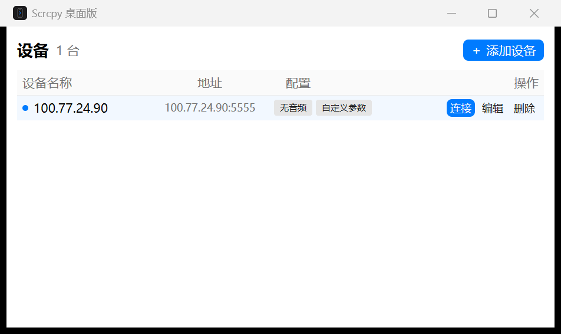
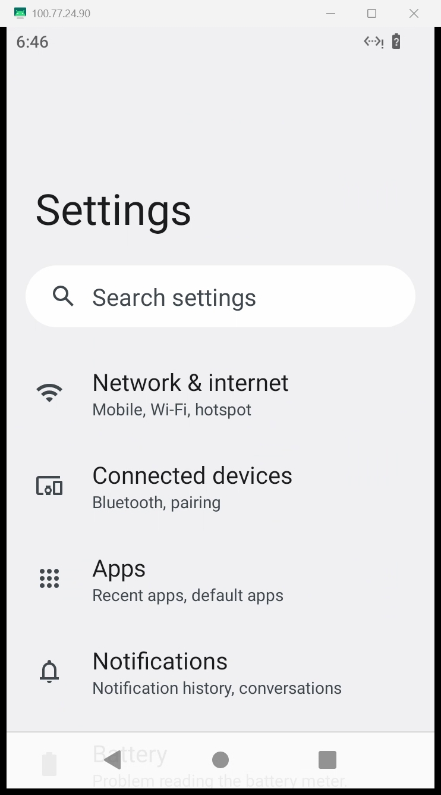

# Scrcpy 桌面版

用 Rust + GPUI 写的 scrcpy 设备管理器：把常用安卓设备存成列表，点「连接」即拉起镜像窗口。scrcpy 5.0.1 运行时已包含在发布包里。

| 设备列表 | 镜像效果 |
| --- | --- |
|  |  |

## 使用

1. 到 [releases](releases) 下载 `scrcpy-desktop-<版本>-win64.zip`（约 19 MB）并解压，保持目录结构：

   ```
   scrcpy-desktop.exe
   scrcpy/            # scrcpy 运行时，必须与 exe 同级
   ```

2. 设备上开启无线调试：`adb tcpip 5555`（与电脑同一局域网）。
3. 双击 `scrcpy-desktop.exe` →「添加设备」填写 IP 与端口 → 保存后点「连接」。

设备配置保存在 `%APPDATA%\scrcpy-desktop\config.json`。音频、置顶、全屏、最大尺寸、码率、帧率等开关对应 scrcpy 的同名命令行参数，另有「自定义参数」输入框可追加任意 scrcpy 选项。

## 常见问题

**点完连接黑屏几秒？** scrcpy 每次都要把 server 推到设备上，实测 4–7 秒，期间界面显示「正在推送 scrcpy-server」，不是卡住。

**模拟器 / redroid 连不上？** 这类系统通常缺少 opus 音频编码器，把设备的「音频」开关关掉即可。

## 许可

Apache-2.0，见 [LICENSE](LICENSE)。`scrcpy/` 目录为 [Genymobile/scrcpy](https://github.com/Genymobile/scrcpy) 5.0.1，同样以 Apache-2.0 授权。
